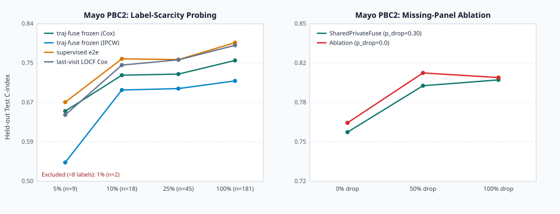

# traj-fuse

**Continuous-time pre-landmark trajectory & missing-panel multimodal survival representation learning (`SharedPrivateFuse`), evaluated via frozen Cox/IPCW probes, missing-assay ablation, and rotation-invariant subspace stability.**

`traj-fuse` addresses three failure modes in longitudinal multimodal biobank modeling (extending unordered bag-of-codes PheRS baselines):
1. **Immortal-time & backfill leakage:** Enforces hard landmark truncation ($T_i > T_L$, $t_{ij} \le T_L$), strict enrollment-only ($t=0$, `skipna=False`) baseline panel extraction, train-only scalers, and an outcome-blind `SSLPretrainSplit` contract.
2. **Radial severity collapse & missing-panel dead paths:** Uses unnormalized split heads (`Time2Vec` + pre-norm SDPA Transformer + `-inf`-masked lag pooling) and a clean/corrupted two-view VICReg + drop-consistency SSL objective (`p_drop=0.30`) that actively trains the missing-panel token $b_{\text{miss}}^{\text{mol}}$ and residual fusion adapter.
3. **Validation label leakage & CCA degeneracy:** Tunes frozen Cox and Kaplan-Meier IPCW linear probes strictly inside the scarce training subset, enforces an explicit identifiability gate (`n >= 8, events >= 3`), and reports Linear CKA, permutation-calibrated ridge SVD-CCA, and orthogonal Procrustes cosine across seeds `(11, 22, 33)`.

---

## Empirical Findings: Mayo `PBC2` & Tier-1 Subspace Benchmark



### 1. Tier-1 Orthogonal Subspace Cohort (`N=1,400`, `D_traj=8`, `D_mol=256`, `25%` Missing Panel)
Evaluated on `N_test = 244` held-out landmarked patients (`N_train = 796`):

| Metric / Evaluation | `traj-fuse` (`p_drop=0.30`) | Comparison / Notes |
|---|---:|---|
| Scarcity `1%` (`n=8`) | `0.644` (Cox) | `last_visit_cox`: `0.582` (`+0.062`), `e2e`: `0.650` |
| Scarcity `5%` (`n=40`) | `0.680` (Cox) | `last_visit_cox`: `0.640` (`+0.040`), `e2e`: `0.682` |
| Scarcity `10%` (`n=80`) | `0.705` (Cox) | `last_visit_cox`: `0.701`, `e2e`: `0.727` |
| Scarcity `100%` (`n=796`) | `0.731` (Cox) / `0.723` (IPCW) | `last_visit_cox`: `0.739`, `e2e`: `0.760` |
| Missing-Panel `0% -> 100%` Drop | `0.731 -> 0.728` (`Δ = -0.004`) | `p_drop=0.0` ablation: `0.715 -> 0.696` (`Δ = -0.019`) |
| Subspace Specificity (SVD-CCA) | `z_shared↔u_shared`: `0.774` | `z_priv_traj↔u_traj`: `0.611` vs `u_mol`: `0.134`; `z_priv_mol↔u_mol`: `0.439` vs `u_traj`: `0.106` |
| 3-Seed Stability `(11, 22, 33)` | Procrustes `0.758`, CKA `0.603` | `excess_cca`: `0.448` (`raw_unaligned_cosine`: `-0.013`) |

### 2. Tier-2 Real Mayo Clinic `PBC2` (`312` Baseline → `278` Landmarked Past $T_L = 2.0$ yr)
Modality 1 (`D_traj = 8`) combines 6 longitudinal serum labs with `age` and `sex_female`; Modality 2 (`D_mol = 6`) extracts enrollment-only (`t = 0.0`, `skipna=False`) staging (`histologic`, `baseline_serChol`, `ascites`, `hepatomegaly`, `spiders`, `edema_score`) with **zero** post-enrollment backfill.

- **Honest Scarcity Gate (`N_train = 181`):** `1%` (`n = 2 < 8`) is logged as `identifiable = False` rather than silently clamped onto `5%`. Identifiable fractions span `5% (n=9)`: `0.653` vs `last_visit_cox` `0.645`; `10% (n=18)`: `0.729`; `25% (n=45)`: `0.732`; `100% (n=181)`: `0.760` (`IPCW`: `0.717`), while supervised end-to-end (`0.798`) and LOCF (`0.792`) benefit from full-sample label supervision on `181` patients.
- **Enrollment Staging vs. 2-Year Labs:** Dropping Modality 2 on `PBC2`'s `56`-patient test split yields `0.760 -> 0.798 (50%) -> 0.803 (100%)`—reflecting that repeated 2-year serum bilirubin/albumin/prothrombin trajectories dominate noisy baseline staging in `PBC2` (in contrast to high-dimensional $p \gg N$ omics in Tier 1).
- **3-Seed Stability `(11, 22, 33)`:** `Procrustes cosine = 0.746`, `Linear CKA = 0.672`, `ridge SVD-CCA = 0.556` (`perm_null = 0.230`, `excess = 0.325`), while `raw_unaligned_cosine = 0.136` confirms why basis-aligned geometry is essential.

---

## 2-Minute Quickstart (100% Offline, `$0` Cost)

```bash
# 1. Install dependencies (Python 3.12 + uv)
uv sync --all-extras

# 2. Run the full 3-seed Mayo PBC2 SSL pretrain -> probes -> ablation -> stability benchmark (<15s CPU)
OMP_NUM_THREADS=1 OPENBLAS_NUM_THREADS=1 \
  uv run traj-fuse run --cohort pbc2 --preset full --out artifacts/pbc2

# 3. Inspect frozen weights_only=True checkpoint (verifies requires_grad=False)
uv run traj-fuse inspect-checkpoint --checkpoint artifacts/pbc2/checkpoint

# 4. Run full test suite + coverage + strict static gates
uv run pytest --cov=traj_fuse --cov-fail-under=90
uv run ruff check src tests scripts && uv run mypy --strict src && uv run pip-audit
```

---

## Architecture & Decision Records

```text
RawLongitudinalCohort ──▶ Landmark Truncation (T_i > T_L, t_ij <= T_L) + t=0 Panel (skipna=False)
                                │
                                ▼
                        SSLPretrainSplit (outcome-blind; zero duration/event/oracle)
                                │
             ┌──────────────────┴──────────────────┐
             ▼                                     ▼
  IrregularTrajectoryEncoder              MolecularEncoder (mask-safe)
  (Time2Vec + pre-norm SDPA + -inf pool)  (zero dropout on obs_mask)
             └──────────────────┬──────────────────┘
                                ▼
                   SharedPrivateFuse (b_miss_mol + zero-init MLP_fuse)
                    ├─ Clean view: L_VICReg + paired-safe L_orth
                    └─ Corrupt view (p_mask=0.20, p_drop=0.30): L_recon + L_drop
                                │
                                ▼
             FrozenSSLCheckpoint (weights_only=True, requires_grad=False)
                    ├─ Scarcity Probes (internal 3-fold CV Cox & IPCW linear)
                    ├─ Missing-Panel Ablation (0% / 50% / 100% drop)
                    └─ Subspace Stability (Linear CKA, SVD-CCA + perm null, Procrustes)
```

- [`docs/adr/0001-landmark-truncation-and-enrollment-panel-firewall.md`](docs/adr/0001-landmark-truncation-and-enrollment-panel-firewall.md)
- [`docs/adr/0002-two-view-vicreg-and-drop-consistent-fusion.md`](docs/adr/0002-two-view-vicreg-and-drop-consistent-fusion.md)
- [`docs/adr/0003-rotation-invariant-cka-cca-procrustes-stability.md`](docs/adr/0003-rotation-invariant-cka-cca-procrustes-stability.md)
- [`data/DATASETS.md`](data/DATASETS.md) — Mayo Clinic `PBC2` (`pbcseq`) provenance, SHA-256 & missingness codebook

---

## Containerized Reproduction

```bash
docker build -t traj-fuse .
docker run --rm -v "$(pwd)/artifacts:/out" traj-fuse \
  run --cohort pbc2 --preset full --out /out/pbc2
```

---

## License

Source code (`src/`, `tests/`, `scripts/`) is licensed under the [MIT License](LICENSE). The bundled Mayo Clinic `PBC2` (`pbcseq`) benchmark artifacts (`data/raw/pbcseq.csv`, `data/pbc2_longitudinal.parquet`) are derived from CRAN `survival::pbcseq` / `JM::pbc2` and remain under their upstream **GPL (>= 2)** license (see [`data/DATASETS.md`](data/DATASETS.md)).
